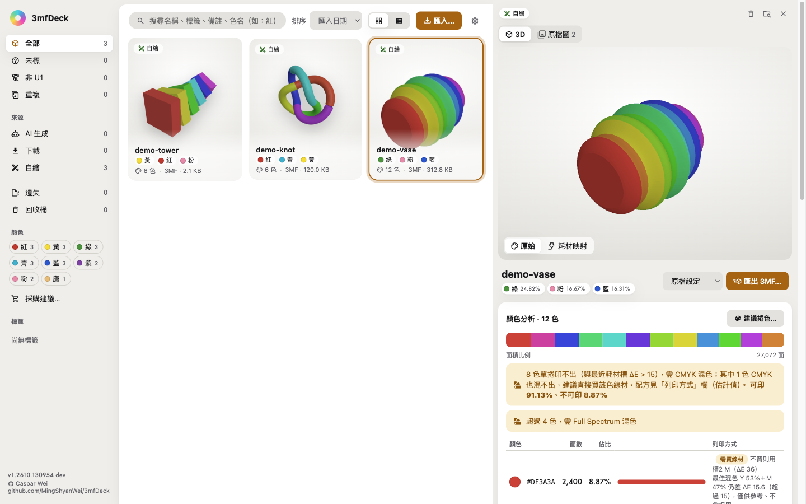
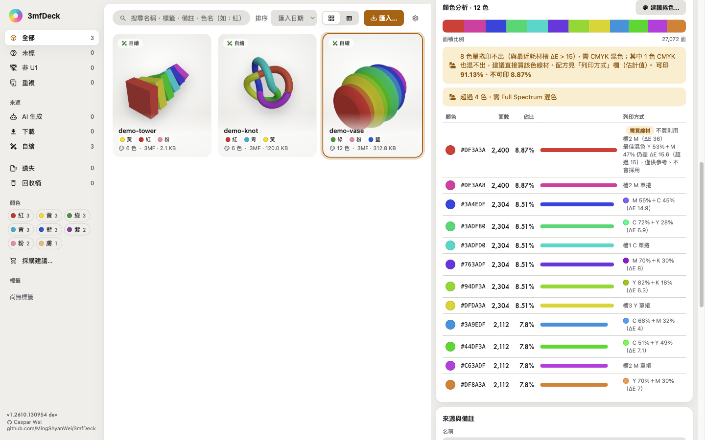
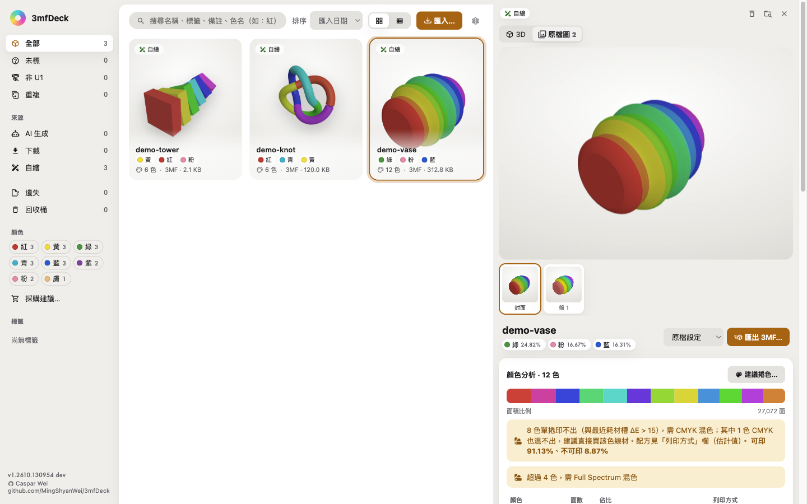
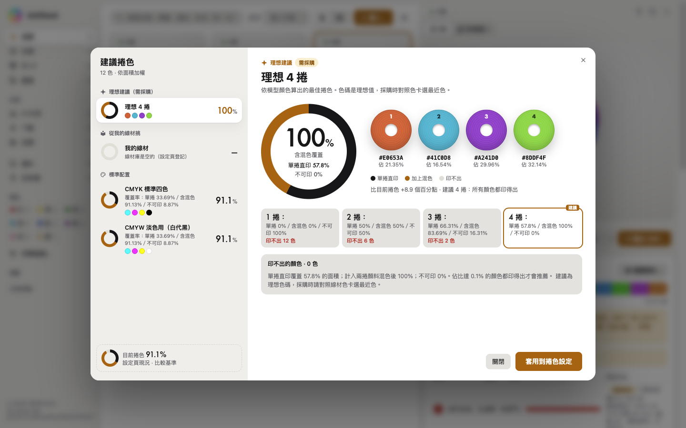
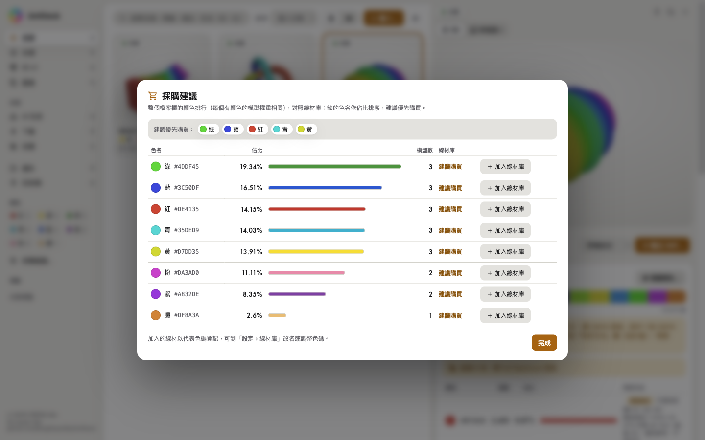
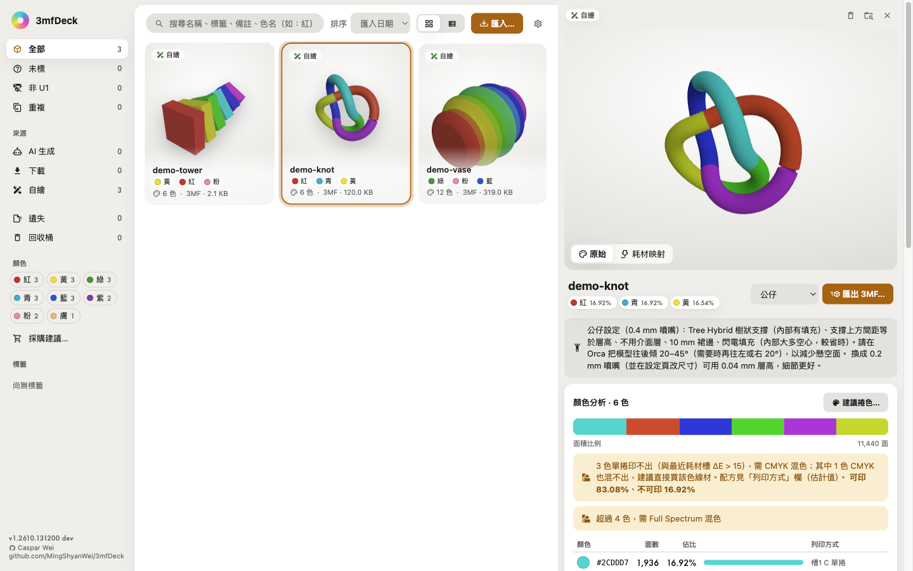
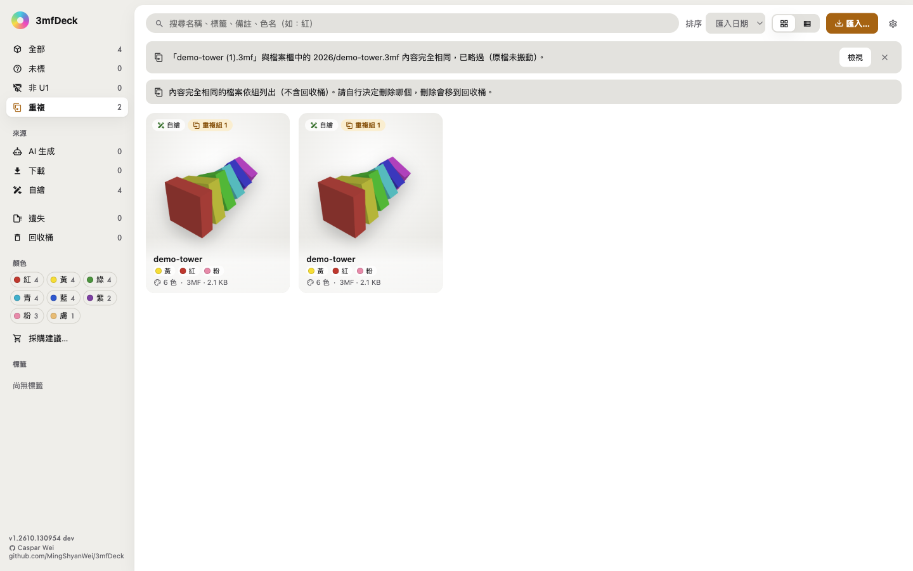
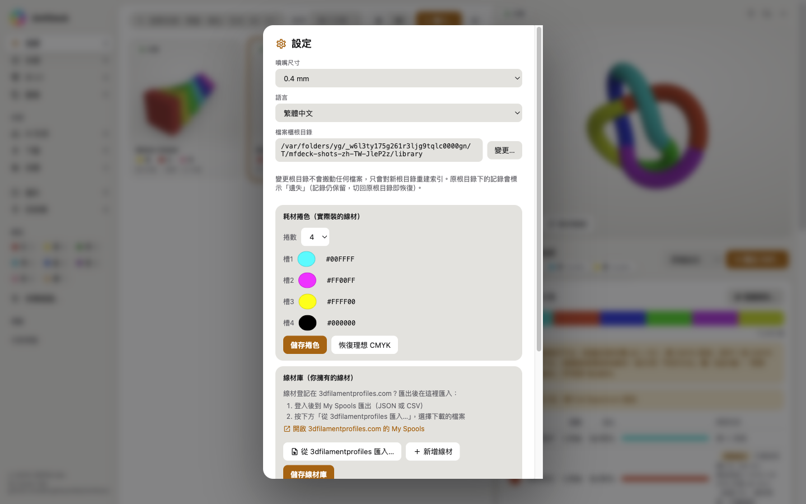

# 3mfDeck

[English](README.md) · **繁體中文** · [简体中文](README.zh-CN.md)

**離線的 3MF 檔案櫃 ＋ 線材配色參謀。**

把散在硬碟、MakerWorld、Meshy 的 3MF 檔收進一個櫃子，看得見 3D、看得懂顏色、算得出該用哪幾捲線材，最後匯出可以直接在 Snapmaker Orca 開啟列印的檔案。



**怎麼用：** 見[使用說明](docs/user-guide.zh-TW.md)（照步驟：匯入、顏色、捲色、匯出、公仔設定、別台印表機的檔案）。

---

## 為什麼做這個

下載模型很容易，之後才是麻煩：

| 痛點 | 3mfDeck 怎麼解 |
|---|---|
| 檔案四散，忘記哪個是原始檔、哪個是轉檔 | 匯入即**搬進**集中資料夾（`~/3mf-library/`，可在設定頁改根目錄），檔案系統為真、DB 只是索引 |
| 開檔才知道長什麼樣 | 櫃子裡直接 **3D 預覽**；MakerWorld 專案還能看到**創作者產品圖與實拍照** |
| 不知道這件作品要用哪幾捲線材 | **顏色分析**（面積加權）＋**建議捲色**（Lab k-means，能 3 捲就不叫你買 4 捲） |
| Full Spectrum 混色全靠猜 | 混色**偵測與配方**：兩捲顏料模型算出混出來的色與 ΔE，告訴你哪一槽幾 % |
| 匯出的 3MF 在 Orca 打開一堆警告 | **匯出 3MF**：剝除不相容的切片設定，只寫幾何＋顏色＋捲色表；混色寫入 Orca 原生 Mix 虛擬擠出頭 |
| 別人分享的檔案不是自家印表機的 | **匯出即 Snapmaker U1**：非 U1 檔案會警示（含來源機型）；匯出 3MF 一律存成 U1 專案（依設定的噴嘴、相容性修正、多盤座標換算到 U1 盤面） |
| 同一個模型下載了兩次、檔名還不一樣 | 依內容**偵測重複**：內容完全相同的檔案不會再匯入（原檔留在原處），「重複」過濾把櫃中相同的檔案分組列出 |
| 刪檔手滑 | 一律進 `.trash/`，可還原，不真刪；同名不覆蓋（加 `-2`） |

---

## 主要功能

**檔案櫃**
- 匯入（選檔／資料夾／拖放）、搜尋、標籤、來源紀錄（MakerWorld／Printables／Meshy／自繪…）、排序、卡片格與表格兩種檢視
- 匯入對話框逐檔填來源（來源類型、平台、網址、AI prompt、標籤、備註）；MakerWorld／Bambu Studio 的 3MF 會依內嵌的設計師、授權、平台自動預填；略過的檔案會列在「未標」提醒補上
- 重複：內容已在櫃中的檔案匯入時略過（即使檔名、資料夾不同）；「重複」過濾把相同的檔案分組列出；不會自動刪除
- 側欄過濾：未標、非 U1、重複、來源、平台、顏色（可多選）、標籤、遺失、回收桶
- 回收桶：刪除即移到 `<根目錄>/.trash/`，可逐一還原，清空需二次確認；詳情面板可「在 Finder 顯示」
- 遺失處置：根目錄換過導致對不上時，標示「遺失」，可逐筆重新定位、依檔名批次找回，或移除記錄（只移除記錄、不刪檔）
- 重建索引：檔案櫃資料夾裡有、索引裡沒有的檔案（例如手動放入）會提示收錄
- 多盤 3MF：每盤分開列出，可切換檢視

**3D 預覽**
- three.js 渲染，三種著色模式（原始顏色／耗材映射／混色估計）
- 詳情面板可切「原檔圖」看 3MF 內嵌的封面、創作者實拍與 Orca 盤面渲染
- 卡片縮圖優先用內嵌產品主圖，沒有才用 3D 渲染

**顏色與線材**
- 顏色分析：逐面 `paint_color`／`basematerials` 解析，面積加權佔比、抖色偵測
- 誠實數字：每個顏色標明怎麼印（單捲、混色附配方、或需買線材——以及不買會印成什麼）；可印與不可印比例一定並列
- 顏色標籤：自動對應固定色名（黑／白／灰／紅／橙／黃／綠／青／藍／紫／粉／棕／膚／金），可依顏色搜尋與過濾；色名用任一介面語言搜尋都找得到（「藍」「蓝」「blue」皆可）
- 線材庫：登記自己的線捲（品牌、材質、RGB、剩餘量），支援匯入 3dfilamentprofiles 的 JSON/CSV
  - 在 3dfilamentprofiles.com 登入後到 [My Spools](https://3dfilamentprofiles.com/my/spools) 匯出（JSON 或 CSV），再到「設定 › 線材庫」按 **從 3dfilamentprofiles 匯入…** 選擇下載的檔案（設定頁也列出相同步驟與 My Spools 連結）
- 建議捲色：從現有線材挑，或給理想色碼；CMYK／CMYW 標準配置比較；單色作品也建議
  - 佔比 0.1% 以上的顏色都印得出才會推薦，小細節不會被主色平均掉；從線材庫挑時會比對所有組合，包括兩捲混出第三色的情況
- 採購建議：統計整個櫃子的面積佔比，對照線材庫算出該優先買哪些顏色

**Snapmaker U1**
- 非 U1 專案（例如 Bambu Lab）會標示原機型，並列在「非 U1」過濾
- 不需另外轉換：匯出 3MF 一律存成 U1 專案——依噴嘴尺寸套用 U1 機型／process／線材設定、啟用 Exclude Object、關閉 Brim（列印設定另有指定除外）、多盤搬到 U1 盤面座標、保留原檔改過的設定與線材流速／溫度／冷卻（每個捲槽採用面積最多的那條原檔線材）；支援超大專案（模型資料超過 1 GB）

**匯出**
- 匯出 3MF：量化到最近捲（含 ΔE 標示），剝除來源切片設定避免 Orca 警告
- 匯出按鈕旁的「列印設定」下拉：**原檔設定**、**公仔**（依 r/PrintedMinis u/HOHansen：噴嘴最低層高、Tree Hybrid 樹狀支撐（內部有填充）且 Top Z＝層高、不用介面層、10 mm 裙邊、Arachne、全速冷卻）或 **公仔＋熨燙**（再熨燙朝上的平面，例如底座）；模型往後傾 20–45° 仍需在 Orca 手動調整
- 混色耗材：寫入 `mixed_filament_definitions`（Orca 原生 Full Spectrum 混合耗材），配方僅供參考、不回寫原檔
- 原檔永不修改，一律產新檔

**設定**
- 噴嘴尺寸（0.2／0.4／0.6／0.8 mm，匯出依此選設定檔）、檔案櫃根目錄、耗材捲色（1–4 捲）、線材庫、語言、更新檢查

**介面語言**
- English／繁體中文／简体中文，預設跟隨系統語言，可在設定頁切換並記住；日期與數字依語言格式化

**網路行為**
- 所有功能離線可用：無帳號、無雲端、不連印表機，檔案不會離開你的硬碟。
- **全 App 唯一的網路行為是更新檢查**：預設開啟，啟動後在背景每 24 小時最多查一次 GitHub Releases API 的最新版本——**查詢會讓 GitHub 看到你的 IP**。到「設定 › 版本與更新」關閉後，App 完全不發出任何網路請求（見[更新](#更新)）。
- 連結（作者、Releases 頁、3dfilamentprofiles.com My Spools）只在你點擊時交給瀏覽器開啟。
- 側欄左下顯示版本號 `1.<YYMM>.<DHHMM>`（建置時間，例如 `1.2610.21122`；發行檔名帶同一字串），滑過去可看完整時間與 commit。

---

## 截圖

截圖全部使用 [`scripts/make-demo-models.mjs`](scripts/make-demo-models.mjs) 產生的示範模型（本專案自製），匯入乾淨的暫存檔案櫃；可用 `node scripts/readme-screenshots.mjs` 重新產生。花瓶的「原檔圖」是該腳本把花瓶本身的渲染圖嵌入 3MF 而來。

| | |
|---|---|
|  **顏色分析**：面積佔比、色名標籤、每色的列印方式 |  **原檔圖**：3MF 內嵌的封面與盤面圖 |
|  **建議捲色**：理想色、從線材庫挑、標準配置 |  **採購建議**：整個檔案櫃最缺哪些顏色 |
|  **列印設定**：匯出按鈕旁選原檔設定、公仔或公仔＋熨燙 |  **重複**：內容相同的檔案分組列出，重複的不會再匯入 |
|  **設定**：噴嘴尺寸、根目錄、耗材捲色 | |

## 支援格式與環境

| 項目 | 內容 |
|---|---|
| 模型格式 | 3MF（完整支援：顏色、多盤、內嵌圖、混色）、STL、OBJ、AMF、GLB／glTF、STEP |
| 平台 | macOS（主要開發與驗證）、Windows、Linux（**見下方限制**） |
| 執行環境（開發） | Node ≥ 24（vitest／vite 在 Node 20 會崩） |

## 安裝

### 從 Releases 下載

到 [GitHub Releases](https://github.com/MingShyanWei/3mfDeck/releases) 下載對應平台的檔案（`<version>` 是建置版本 `1.<YYMM>.<DHHMM>`，例如 `1.2610.21122` = 2026-10-02 11:22，與 App 側欄左下顯示的字串相同；日不補零是因為 semver 不允許前導零）。各版檔案的 SHA256 見 [docs/release-manifest.md](docs/release-manifest.md)。

| 平台 | 檔案 | 說明 |
|---|---|---|
| macOS（Apple 晶片） | `3mfDeck-<version>-arm64.dmg` | 打開後把 3mfDeck 拖進「應用程式」 |
| Windows x64 | `3mfDeck-<version>-win-x64-setup.exe` | 安裝版（可選安裝位置） |
| Windows x64 | `3mfDeck-<version>-win-x64-portable.exe` | 免安裝版，直接執行 |
| Linux x64 | `3mfDeck-<version>-linux-x64.AppImage` | `chmod +x` 後直接執行 |
| Linux x64（Debian／Ubuntu） | `3mfdeck_<version>_amd64.deb` | `sudo apt install ./3mfdeck_<version>_amd64.deb` |

**macOS：此版未簽章（僅 ad-hoc 簽章，未用 Developer ID、未公證）**，第一次開啟會被 Gatekeeper 擋下，請擇一：
- 在「應用程式」裡對 3mfDeck **右鍵 →「打開」→「打開」**；若沒有「打開」按鈕，到 **「系統設定 › 隱私權與安全性」**，按 3mfDeck 訊息旁的 **「強制打開」**；或
- 在終端機執行 `xattr -dr com.apple.quarantine /Applications/3mfDeck.app`，之後正常開啟。

若要下載後免警告開啟，需 Apple Developer Program 簽章＋公證，不在本版範圍。

**Windows：** `.exe` 也未做程式碼簽章；SmartScreen 若警告，請按「其他資訊 → 仍要執行」。

### 更新

3mfDeck 不會自己下載或安裝更新——**更新一律手動**到 [Releases](https://github.com/MingShyanWei/3mfDeck/releases) 下載安裝（macOS 的 App 內自動更新需要 Developer ID 簽章，本版為 ad-hoc 簽章）。

- **設定 › 版本與更新**：顯示目前版本，以及「開啟 Releases 頁面」按鈕（交給系統瀏覽器，App 不發請求）。
- **自動檢查更新（會連線 GitHub）**：**預設開啟**。App 啟動後在背景每 24 小時最多一次向 GitHub Releases API 查詢最新版，以 release 說明中的建置標記（`<!-- build: 1.YYMM.DHHMM -->`）與本機版本比對；有新版時在側欄顯示小提示（前往下載／略過此版本／關閉），同版不顯示。不會拖慢啟動；離線或 API 限流時靜默略過。
- 這是 App 唯一的網路行為，會讓 GitHub 看到你的 IP。**關閉後 App 完全不發出任何網路請求。**

## 開發

```bash
git clone git@github.com:MingShyanWei/3mfDeck.git
cd 3mfDeck
npm install
npm run dev        # vite build + 啟動 Electron
npm test           # Vitest 單元測試（337 項）
npm run smoke      # Electron 端到端 smoke（用隔離的資料夾與資料庫）
npm run dist       # 打包 macOS dmg（檔名帶建置版本）
node scripts/release-notes.mjs  # 產生含建置標記、大小、SHA256 的 release 說明
```

常用環境變數（測試用）：

| 變數 | 用途 |
|---|---|
| `MF_USER_DATA` | 指定 userData 目錄（隔離測試） |
| `MF_APP_PATH` | 對安裝版 App 跑 smoke（例：`/Applications/3mfDeck.app/Contents/MacOS/3mfDeck`） |
| `MF_WINE_3MF` | 指定真實 3MF 檔做實檔驗證 |
| `MF_LANG` | 未在設定頁選過語言時使用的介面語言（`en`／`zh-TW`／`zh-CN`） |

## 專案結構

```
electron/          Electron 主程序（視窗、IPC、自訂圖片協定 mfimg/mfthumb）
src/core/          純邏輯，可單獨測試：解析、顏色、混色、匯出（即 U1）、DB、設定
  parse/           3MF／STL／OBJ／AMF／GLB／STEP 解析
  u1Convert.mjs    Snapmaker U1：機型偵測、設定檔、盤面換算（供匯出使用）
  orcaProfiles.mjs 讀本機 Snapmaker Orca 的機型 profile（僅取幾何資料，不連網）
src/core/i18n/     介面字典（en／zh-TW／zh-CN）
src/renderer/      React UI（three.js 預覽、詳情面板、彈窗）
tests/unit/        Vitest（36 個檔、337 項）
tests/smoke/       真實 Electron 端到端測試
docs/user-guide*.md 使用說明（en／zh-TW／zh-CN）
docs/screenshots/  README 截圖（en／zh-TW／zh-CN）
demo/models/       程序化產生的示範模型（可用 node scripts/make-demo-models.mjs 重新產生）
scripts/           測試素材、示範模型與截圖產生腳本
SPEC.md            完整功能規格（已定稿）
```

## 設計原則

1. **檔案系統為真**：DB 只是索引，刪掉能從檔案重建。
2. **刪檔不真刪**：一律進 `.trash/`，可還原。
3. **原檔永不動**：匯出一律產新檔。
4. **匯入即搬檔**：集中管理，不搬不給匯入。
5. **離線可用**：任何功能都不需要網路；唯一的網路行為是可關閉的更新檢查。

## 已知限制

- **Windows／Linux 未有實機驗證**：安裝檔是在 macOS 上用 electron-builder 內建的 Wine／Linux 工具組（或 CI runner）產出，尚未在實機跑過 smoke；macOS 是唯一完成端到端驗證的平台。
- **Orca CLI 不能用來驗 3MF**：沒載印表機 profile 會 segfault（`exit 139`），連原始檔也一樣。驗證一律以 **Orca GUI 開啟**為準。
- **混色配方無法逐面寫兩捲**：Orca 逐面只記一捲，因此混色以虛擬擠出頭（Mix）表達。
- **大檔案**：內含 500MB 以上模型（如某些 Meshy 匯出）需用串流解析，處理時間較長。

## License

**MIT** — see [LICENSE](LICENSE).

Third-party components keep their own licenses; see the notices in [LICENSE](LICENSE).
In short: the pigment mixing model is MIT (Justin Hayes, ported from
[OrcaSlicer-FullSpectrum](https://github.com/ratdoux/OrcaSlicer-FullSpectrum)); the
Snapmaker U1 conversion is original to this project and reads machine geometry from a
locally installed Snapmaker Orca at runtime.

## Author

**Caspar Wei** ([@MingShyanWei](https://github.com/MingShyanWei)) — [github.com/MingShyanWei/3mfDeck](https://github.com/MingShyanWei/3mfDeck)
