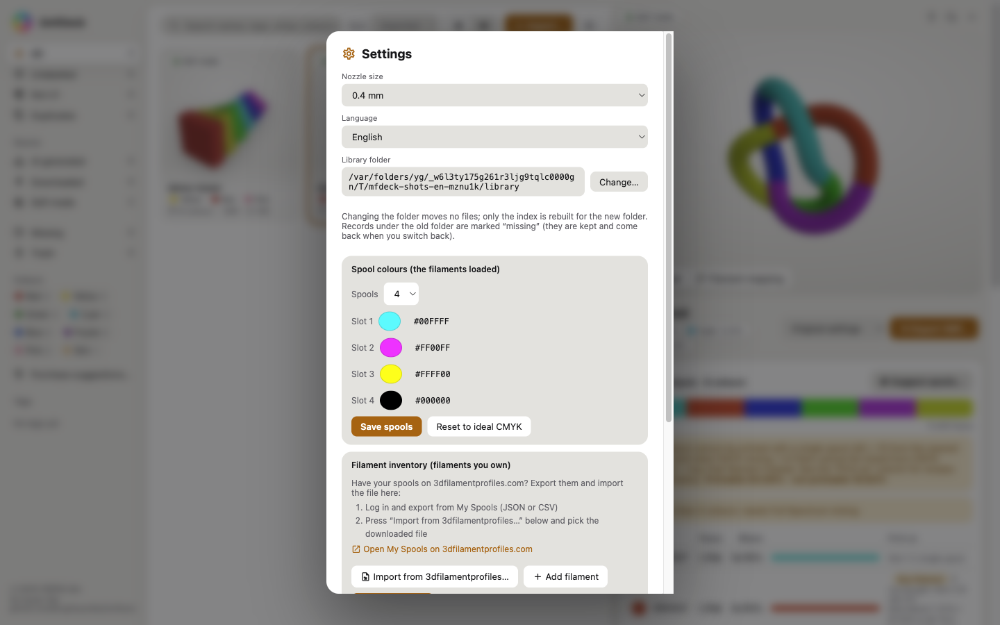
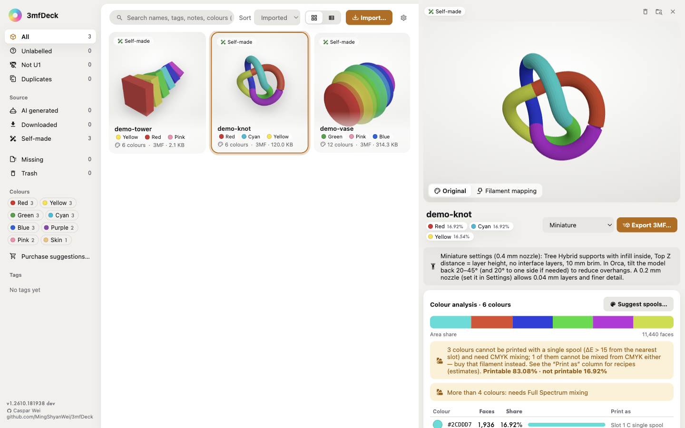
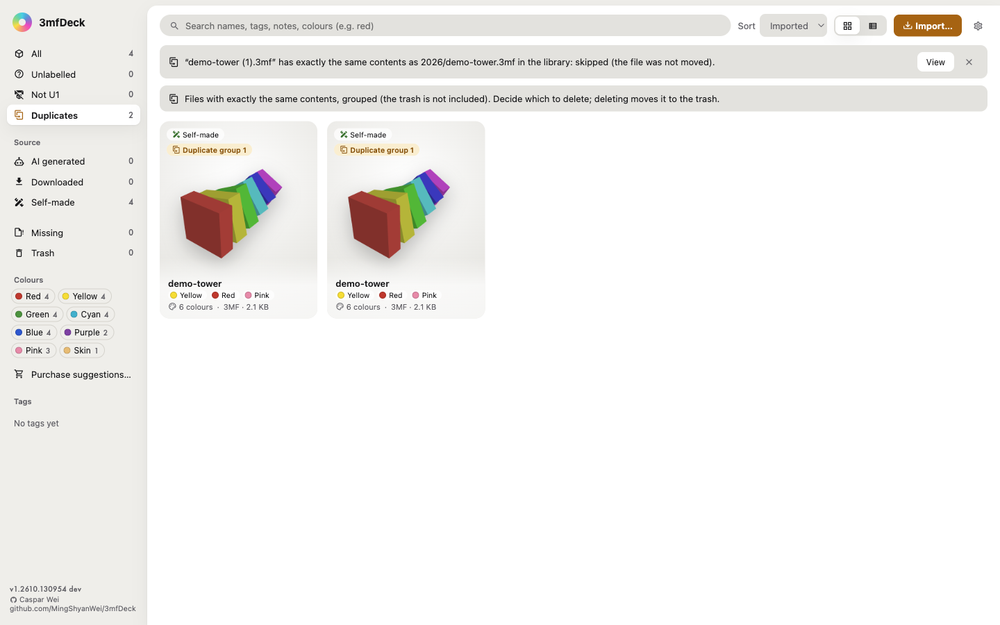

# 3mfDeck user guide

**English** · [繁體中文](user-guide.zh-TW.md) · [简体中文](user-guide.zh-CN.md) · back to the [README](../README.md)

This guide follows the order you actually work in: put files into the library, look at their colours, decide on filaments, then export to Snapmaker Orca and print. For installation see [Install](../README.md#install) in the README.

- [1. First start](#1-first-start)
- [2. The window](#2-the-window)
- [3. Importing files](#3-importing-files)
- [4. Organising and finding](#4-organising-and-finding)
- [5. Looking at a model: 3D preview and embedded images](#5-looking-at-a-model-3d-preview-and-embedded-images)
- [6. Colour analysis: can this be printed?](#6-colour-analysis-can-this-be-printed)
- [7. Choosing which spools to load](#7-choosing-which-spools-to-load)
- [8. Filament inventory and purchase suggestions](#8-filament-inventory-and-purchase-suggestions)
- [9. Exporting a 3MF for Snapmaker Orca](#9-exporting-a-3mf-for-snapmaker-orca)
- [10. Miniature settings](#10-miniature-settings)
- [11. Files made for other printers (exported as U1)](#11-files-made-for-other-printers-exported-as-u1)
- [12. Duplicates, missing records and the trash](#12-duplicates-missing-records-and-the-trash)
- [13. Settings](#13-settings)
- [14. FAQ](#14-faq)

---

## 1. First start

1. Open 3mfDeck (on macOS, Gatekeeper blocks the first launch; see the README).
2. Open **Settings** (gear, top right) and check three things:
   - **Nozzle size**: the nozzle currently on your U1 (0.4 mm by default). The export picks the Orca presets for this nozzle.
   - **Library folder**: `~/3mf-library/` by default. To keep it in iCloud Drive or on an external disk, change it here (see [section 13](#13-settings)).
   - **Spool colours**: the filament colours actually loaded on the U1 (ideal CMYK by default). Colour analysis, mixing recipes and export are all computed with these.
3. Exporting another printer's project and the **Miniature** settings need **Snapmaker Orca** installed locally (`/Applications/Snapmaker Orca.app`). The app only reads its preset files; nothing goes online.

## 2. The window

| Area | What is there |
|---|---|
| Left sidebar | Filters: All, Unlabelled (no source yet), Not U1, Duplicates, source (AI generated / Downloaded / Self-made), platform (MakerWorld…), Missing, Trash; colours (multi-select) and tags; at the bottom "Purchase suggestions…" and the version |
| Toolbar | Search, sort (Imported / Name / Colours), Cards or List, "Import…", Settings |
| Centre | Cards or a list. Card badges: source, colour count, plates, Not U1, duplicate group, missing |
| Detail panel (right) | Opens when you click a card: 3D preview, export, colour analysis, source and notes, file info |

## 3. Importing files

Drag files or folders onto the window, click **Import…**, or use **File › Import…**. Supported: `.3mf .stl .obj .amf .glb .gltf .step .stp`.

- **Files are moved into the library** (`<library>/<year>/<file name>`), not copied. A different file with the same name gets `-2`, `-3`; nothing is overwritten.
- **Files whose contents are already in the library are not imported again** (for a 3MF the model, settings and images inside count, so the same project saved again at another time is still the same), whatever their name or folder. The source stays where it was, untouched, and a notice names the existing copy (click "View" to jump to it). If the identical file is in the trash, the notice points you there to restore it.
- After importing, the **import dialog** asks for each file's source: source type (AI generated / Downloaded / Self-made), platform, URL, AI prompt, date retrieved, tags (comma-separated) and notes.
  - MakerWorld / Bambu Studio 3MF files are **pre-filled** from their embedded data (designer, licence, platform); usually you just click "Save and next".
  - "Skip this file" or "Skip all" leaves them for later; the **Unlabelled** filter keeps listing them as a reminder.

## 4. Organising and finding

- **Search** looks in names, tags, notes and **colour names** (type "red" to find models with red; Chinese colour names work too).
- **Colour filter**: click a colour in the sidebar to list files where that colour covers at least 5 % of the surface; with several colours selected, a file must contain all of them.
- **Edit** the name, source, tags and notes in "Source & notes" in the detail panel at any time.
- **Show in Finder**: the folder icon at the top right of the detail panel.
- **Delete**: the bin icon at the top right of the detail panel moves the file to the trash, from where it can be restored (see [section 12](#12-duplicates-missing-records-and-the-trash)).

## 5. Looking at a model: 3D preview and embedded images

- The detail panel opens with a 3D preview: drag to rotate, scroll to zoom. Shading modes:
  - **Original**: the file's own colours.
  - **Filament mapping**: each colour as it will be printed with your spools (single spool or mix), i.e. what the export will look like.
  - **Mix estimate**: only for Full Spectrum dithered files; simulates how the dithering blends from a distance (an estimate; Orca is the reference).
- **Images** tab: the cover, the creator's photos and Orca plate renders inside MakerWorld projects. Cards also use the cover as their thumbnail.
- **Multi-plate 3MF**: each plate can be viewed and analysed on its own.
- STEP files cannot be previewed yet (they can still be kept in the library).

## 6. Colour analysis: can this be printed?

The "Colour analysis" card in the detail panel (3MF only):

- **Area bar**: each colour's share of the model's surface area.
- **How to print**, per colour:
  - **Slot N single spool**: one spool is close enough (small ΔE).
  - **Mix**: two spools mixed with Orca's Full Spectrum mixed filament (Mix), with the recipe and ΔE.
  - **Buy filament**: no mix of your spools gets close enough. It also says "if not bought: slot N (ΔE)", i.e. what you will get if you print anyway.
- **Printable / not printable** share, e.g. "Printable 97.66% · not printable 2.34%" — never just the flattering number.
- **Dither?**: two almost identical colours that are probably one area split by dithering are flagged.
- **More than 4 colours**: a notice says Full Spectrum mixing is needed.

## 7. Choosing which spools to load

Click **Suggest spools…** in the colour analysis:

- **Ideal**: the best 1–4 spool colours for this model (when buying, pick the nearest colour on a swatch card).
- **From my filaments**: tries every combination from your inventory ([section 8](#8-filament-inventory-and-purchase-suggestions)) and picks the fewest spools that can print every colour, including colours that two spools mix into.
- **Standard sets**: CMYK and CMYW coverage for comparison.
- Every option shows single-spool / with mixing / not printable shares. An option is marked "recommended" only if every colour covering at least 0.1 % can be printed, so small details (eyes, nose) are not averaged away by the main colour.
- **Apply to spool settings** makes filament mapping, mixing recipes and export use that set.

## 8. Filament inventory and purchase suggestions

- **Filament inventory** (Settings): register the filaments you own (name, colour). Or export JSON / CSV from [My Spools on 3dfilamentprofiles.com](https://3dfilamentprofiles.com/my/spools), click "Import from 3dfilamentprofiles…", check the list and click "Save inventory".
- **Purchase suggestions** (bottom of the sidebar): ranks the colours of the whole library (every coloured model counts the same), compares them with your inventory and lists which missing colours to buy first; "Add to inventory" registers one directly.

## 9. Exporting a 3MF for Snapmaker Orca

At the right of the detail panel's title bar:

1. Choose the **print settings** in the drop-down:
   - **Original settings**: normal printing.
   - **Miniature** / **Miniature + ironing**: see [section 10](#10-miniature-settings).
2. Click **Export 3MF…** and choose where to save.

What the export does:

- Every colour is quantized to a spool; colours no single spool can print become Orca's native **mixed filaments (Mix)**, so colours are set up as soon as Orca opens the file.
- The source's slicing settings are stripped; only geometry, colours, the spool table and U1 preset names remain, so Orca shows no compatibility warnings.
- The printer and process presets follow the **nozzle size** in Settings.
- It is always a **Snapmaker U1 project**: Exclude Object on, brim off (except Miniature); another printer's project is moved onto the U1 bed as well (see [section 11](#11-files-made-for-other-printers-exported-as-u1)).
- **The original file is never modified**; every export is a new file.

## 10. Miniature settings

Based on r/PrintedMinis "[FDM miniatures - How I support them and some updates](https://www.reddit.com/r/PrintedMinis/comments/1i8hcyz/fdm_miniatures_how_i_support_them_and_some_updates/)" (u/HOHansen), scaled to your nozzle. Exporting with "Miniature" writes:

| Setting | Value |
|---|---|
| Layer height | the nozzle's lowest (0.2→0.04, 0.4→0.08, 0.6→0.12, 0.8→0.16 mm) |
| First layer | 0.2 mm (so supports and brim stick) |
| Supports | on, tree (Tree Hybrid style); top Z distance = layer height; no interface layers; infill inside the supports (rectilinear, 1.2 mm spacing) |
| Brim | outer only, 10 mm (covers the support bases) |
| Walls | Arachne, minimum feature size 30 % |
| Interior | The U1 default (not changed) |
| Line width | 0.2 on the 0.2 nozzle; U1 defaults on the others |
| Cooling | fans 100 % except the first layer |
| Z-hop on retraction | already on in the U1 presets, left as is |

**Miniature + ironing** adds ironing of **every upward-facing flat surface** (e.g. the top of a flat base), with an ironing line spacing of 25 % of the nozzle (0.1 mm on 0.4). Small upward ledges on the figure are ironed too; check the details in the slice preview.

**What you must still do yourself** (a file cannot set it): in Orca, **tilt the model back 20–45°** (and 20° to one side if needed). That reduces overhangs and support scars a lot.

> **Why Tree Hybrid**: one of the post's key points is **infill inside the tree supports**, so they do not break mid-print. The U1's default tree style is Organic, whose branches are always hollow and which ignores the infill setting; Tree Hybrid fills them (tested on the same model: Organic supports were a single shell, Tree Hybrid had infill lines 1.2 mm apart). It costs about 3 % more filament and 2 % more print time, and large flat overhangs get normal supports underneath, which are harder to remove.

## 11. Files made for other printers (exported as U1)

Shared 3MF files are often projects for another printer (e.g. Bambu Lab). Opened as they are, they keep that printer's bed, and objects may end up outside the U1's.

- Such files show a **Not U1** warning (with the original printer) on the card and in the detail panel; the **Not U1** filter lists them all.
- Nothing to convert: **Export 3MF…** ([section 9](#9-exporting-a-3mf-for-snapmaker-orca)) always writes a U1 project, and the original is left untouched. The export:
  - switches printer, process and filament presets to U1, **for the nozzle size in Settings** (not the source's nozzle);
  - moves each plate's objects to U1 bed coordinates; a plate that cannot be moved safely stays where it was, and the export message says why;
  - keeps some of the source's changed settings (e.g. supports, infill density) and its filament settings (temperature, flow, cooling). Each spool slot takes the settings of the source filament with the most area mapped to it; where they clash with a print preset (Miniature…), the preset wins.
- Very large projects (over 1 GB of model data) export too; it just takes longer.

## 12. Duplicates, missing records and the trash

- **Duplicates** (sidebar): files in the library with identical contents, grouped and marked "Duplicate group N". You decide which to delete; nothing is deleted automatically. Older files get their fingerprint in the background after startup; iCloud files not downloaded to this Mac are skipped until they are.
- **Missing**: the record exists but its file is not under the current library folder (the folder was changed, or the file was moved by hand).
  - One file: **Relocate…** in the detail panel points the record at the file's new place.
  - Many files: **Find by file name…** looks for files with the same names under the library folder (including subfolders) and applies the matches after you confirm; nothing is moved.
  - Not needed any more: select them and **Remove selected…** removes the records only; no file is deleted.
- **Trash**: deleted files are kept in `<library>/.trash/` and can be **restored** one by one; **Empty trash…** deletes them for good after a second confirmation.
- **Rebuild index**: if files are in the library folder but not indexed (e.g. copied in by hand), a notice appears at the top; **Rebuild index** adds them.

## 13. Settings

| Setting | |
|---|---|
| Nozzle size | 0.2 / 0.4 / 0.6 / 0.8 mm; used for the export presets |
| Language | English / 繁體中文 / 简体中文; follows the system by default |
| Library folder | changing it **moves no files**: the new folder is indexed and records under the old one are marked missing (switch back to restore them) |
| Spool colours | the real colours of 1–4 spools; "Reset to ideal CMYK" restores the default |
| Filament inventory | see [section 8](#8-filament-inventory-and-purchase-suggestions) |
| Version & updates | current version, open the Releases page, automatic update check |

**Updates**: by default the app checks GitHub for a newer release in the background, at most once every 24 hours, and shows a notice in the sidebar (download / skip this version / close). This is the app's only network activity and can be switched off here. Updates are always downloaded and installed by hand.

## 14. FAQ

**The miniature settings did not apply when I opened the export in Orca.**
Use 3mfDeck 1.2610.110033 or later; Orca ignores the settings written by older builds.

**A file was not imported. Why?**
Read the notice: a file identical to one already in the library is skipped (the source stays where it was); unsupported formats are skipped too.

**Do I have to buy the "Buy filament" colours?**
No. The row also says "if not bought: slot N (ΔE)"; if that difference is acceptable, just print.

**I changed the library folder and everything is "missing".**
Changing the folder moves no files, so records under the old folder are marked missing. Switch back to restore them, or use **Find by file name…** to match them to the new place.

**The export says Snapmaker Orca was not found.**
Both read the presets of a locally installed Snapmaker Orca; install it first.
